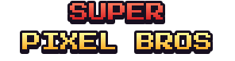

<div align="center">



# SUPER PIXEL BROS - MOBILE UPDATE

**A Touch-First Retro Pixel Platformer with 20 Levels, Power-Ups, Chiptune Music, and a Cosmetic Shop**

[]()
[]()
[]()
[]()
[]()
[]()

[About](#about) | [Getting Started](#getting-started) | [Gameplay](#gameplay) | [Shop and Cosmetics](#shop-and-cosmetics) | [Controls](#controls) | [Development](#development) | [Configuration](#configuration) | [Project Structure](#project-structure) | [Credits and License](#credits-and-license) | [Disclaimer](#disclaimer)

---

## About

SUPER PIXEL BROS is a classic side-scrolling pixel platformer built for phones and tablets. You run, jump, stomp enemies, break bricks, grab power-ups, and race to the flagpole across 20 hand-designed levels split into 2 chapters and 9 world themes. The game features modern jump physics (variable jump height, coyote time, and jump buffering), a chiptune soundtrack, and a complete pixel-art interface.

The Mobile Update makes the game touch-first. Seven on-screen buttons appear during play with full multi-touch support, and every button can be moved, resized, made transparent, or hidden from a built-in layout editor. A keyboard or gamepad connected to the device (USB, OTG, or Bluetooth) keeps working at the same time.

Every coin you pick up also fills a permanent wallet that is spent in the **SHOP** on skins, suits, hats, face items, back items, and particle trails. Owned items can be mixed freely, and the equipped look is used in every level.

Every sprite, tile, background, sound effect, and music track is generated from scratch by the Python scripts in `tools/`, so the project contains no third-party game art or audio. The game runs on Godot 4.7 with the GL Compatibility renderer.

---

## Getting Started

The simplest way to play is to export a build for your device (see [Exporting a Build](#exporting-a-build)) or to run the project directly from the Godot editor (see [Development](#development)).

### System Requirements

| Item | Requirement |
|---|---|
| Operating System | Android (arm64, armv7, x86, x86_64) or iOS 15.0 and later |
| Graphics | Any GPU with OpenGL compatibility support (the game uses the GL Compatibility renderer) |
| Display | 400x224 pixel base resolution in landscape orientation, scaled to any screen size |
| Input | Touchscreen. Keyboard and gamepad are optional and work together with touch |
| Players | 1 player |

### Quick Play

1. Launch the game and tap **START GAME**.
2. Pick an unlocked level on the level select screen.
3. Run to the flagpole before the timer runs out.
4. Collect coins along the way and spend them in the **SHOP** from the main menu.
5. Clearing a level unlocks the next one. Clearing level 10 opens Chapter 2.

---

## Gameplay

### Chapters and Levels

| Chapter | Levels | Unlocked By | New Elements |
|---|---|---|---|
| Chapter 1 | 1 to 10 | Available from the start | Core mechanics, 7 world themes, checkpoints, moving platforms |
| Chapter 2 | 11 to 20 | Clearing level 10 | Warp pipes, bats, springs, star blocks, fire bars, falling platforms, crushers, jungle and space themes |

Use the `<` and `>` buttons on the level select screen to switch chapters (Q / E or LB / RB also work). Levels unlock in order, and each level card shows a medal when the level is cleared, plus the best score.

| No. | Level | Theme | Time | No. | Level | Theme | Time |
|---|---|---|---|---|---|---|---|
| 1 | Green Hills | Grass | 300 | 11 | Warp Valley | Jungle | 330 |
| 2 | Dune Run | Desert | 320 | 12 | Vine Run | Jungle | 340 |
| 3 | Crystal Cave | Cave | 340 | 13 | Bat Cave | Cave | 350 |
| 4 | Frosty Peaks | Snow | 340 | 14 | Spring Dunes | Desert | 350 |
| 5 | Midnight Run | Night | 330 | 15 | Ice Steps | Snow | 360 |
| 6 | Sky High | Sky | 320 | 16 | Moonwalk | Space | 340 |
| 7 | Ancient Ruins | Desert | 350 | 17 | Crater Crush | Space | 360 |
| 8 | Blizzard Pass | Snow | 360 | 18 | Midnight Bats | Night | 370 |
| 9 | Fire Fortress | Castle | 380 | 19 | Lava Forge | Castle | 400 |
| 10 | Final Castle | Castle | 420 | 20 | King's Return | Castle | 440 |

Each theme has its own sky colors, parallax backgrounds, decorations, music, and atmosphere effects (snow, dust, or embers). The Space theme uses low gravity.

### Hero Forms and Power-Ups

The hero has three forms. Taking a hit as Big or Fire shrinks the hero back to Small with a short period of invincibility. Taking a hit as Small costs a life.

| Form | How To Get It | Abilities |
|---|---|---|
| Small | Default | Dies when hit |
| Big | Mushroom | Breaks bricks from below and survives one hit |
| Fire | Fire Flower | Throws fireballs with the FIRE button (up to 2 on screen) |

| Item | Effect |
|---|---|
| Coin | Gives 200 points and adds 1 coin to the shop wallet. 100 coins in one run give 1 extra life |
| Mushroom | Grows the hero to Big |
| Fire Flower | Turns the hero into Fire |
| Star | 9 seconds of invincibility (from star blocks in Chapter 2) |
| 1UP | Adds one extra life |

### Blocks, Hazards, and Enemies

| Category | Elements |
|---|---|
| Blocks | Brick (breaks when Big), coin block, power-up block, star block, hard block |
| Platforms | Static one-way platforms, horizontal and vertical moving platforms, falling platforms |
| Hazards | Spikes, lava, bottomless pits, fire bars, crushers, and slippery ice in snow levels |
| Helpers | Springs (hold JUMP for full height), warp pipes that lead to bonus rooms or shortcuts, checkpoints |
| Enemies | Goomba-like walker, Koopa-like walker (stomp it and kick the shell), Piranha plant that rises from pipes, and flying bats (Chapter 2) |

Enemies can be defeated by stomping, fireballs, a shell kick, or star invincibility. To use a warp pipe, stand on top of the pipe with the bobbing arrow and tap **DOWN**.

### Scoring, Lives, and Progress

| Rule | Detail |
|---|---|
| Lives | A new run starts with 3 lives. 100 coins or a 1UP item give an extra life |
| Stomp combo | Consecutive stomps without touching the ground score 100, 200, 400, 500, 800, 1000, 2000, 4000, 5000, and up to 8000 |
| Flagpole | Grabbing the pole higher gives more points, then the hero walks into the castle |
| Time bonus | 50 points for every second left on the clock. A warning plays when the time is low |
| Checkpoints | Touching a checkpoint flag saves your position for the current level |
| Best score | The best score for every level is saved and shown on the level cards |
| Clear reward | Every course clear pays 10 bonus coins into the shop wallet |

Pausing opens a menu with **RESUME**, **RESTART LEVEL**, **CONTROLS**, **LEVEL SELECT**, and **MAIN MENU**.

---

## Shop and Cosmetics

The **SHOP** is opened from the basket button on the main menu. It shows a live animated preview of your hero, category tabs, an item grid, and an info bar. Buying an item asks for confirmation first. Equipped items are applied immediately and used in every level.

| Category | Items | Price Range (coins) | Notes |
|---|---|---|---|
| Skin | 12 | 40 to 250 | Full color sets. Classic is free |
| Suit | 12 | 25 to 200 | Outfits such as Farmer, Pirate, Ninja, Royal, and Rainbow. Original is free |
| Hat | 11 | 15 to 200 | Beanie, Top Hat, Wizard Hat, Halo, Crown, and more |
| Face | 7 | 15 to 60 | Glasses, masks, eyepatch, and big beard |
| Back | 7 | 30 to 160 | Backpack, capes, angel and demon wings, jetpack |
| Trail | 6 | 25 to 120 | Bubbles, snowfall, sparkle, hearts, flames, rainbow |

In total there are 55 cosmetic items (2 free, 53 purchasable). Skin and suit always have one item equipped, while hat, face, back, and trail can be removed. All cosmetics are drawn at runtime from the same pixel maps as the base hero, so no extra image files are needed. The wallet, owned items, and equipped loadout are saved automatically.

---

## Controls

### Touch Buttons

Seven round buttons are drawn over the level. Each finger is tracked separately, so you can press several buttons at once, and sliding a finger from one button to another switches the pressed button without lifting it.

| Button | Function |
|---|---|
| LEFT / RIGHT | Move |
| DOWN | Enter a warp pipe, crouch |
| JUMP | Jump (hold for a higher jump) |
| RUN | Hold to run |
| FIRE | Throw a fireball (while in Fire form) |
| PAUSE | Open the pause menu |

### Touch Settings

Open **OPTIONS > TOUCH CONTROLS**, or **PAUSE > CONTROLS** while playing.

| Setting | Description |
|---|---|
| Touch Buttons | Display mode: AUTO (touchscreen devices), ALWAYS ON, or OFF |
| Opacity and Size | Global multipliers applied to every button |
| Haptic | Short vibration on each press (Android) |
| Auto Run | Keeps RUN held while the touch buttons are on screen |
| Hide If Pad | Hides the buttons while a gamepad is connected (AUTO mode) |
| Edit Buttons | Opens the layout editor |

### Layout Editor

| Action | Description |
|---|---|
| Move | Drag any button to a new position |
| Size | Per-button size from 50% to 180% |
| Opacity | Per-button opacity from 10% to 100% |
| Hide or Show | Hide buttons you do not need |
| Reset | Reset the selected button or reset all buttons |

Changes apply live and are saved when you press **DONE** or **BACK**. The Android Back button pauses the game while playing, goes back in menus, and closes the editor.

### Keyboard and Gamepad (Optional)

Bindings are fixed. Any keyboard or gamepad connected through USB, OTG, or Bluetooth works together with the touch buttons.

| Action | Keyboard | Gamepad |
|---|---|---|
| Move | Arrows or A / D | Left stick or D-pad |
| Jump | Space, Z, K, W, or Up arrow | A or Y |
| Run and throw fireball | Shift, X, or J | X, B, or right trigger |
| Enter warp pipe | Down arrow or S | Down on stick or D-pad |
| Pause | Esc or P | Start |
| Menus | Mouse or touch | A or X to select, B to go back |

### Options

| Setting | Description |
|---|---|
| Music | Music volume slider |
| Sound | Sound effect volume slider |
| Fullscreen | Fullscreen on or off (desktop only, hidden on mobile) |
| Touch Controls | Touch settings and layout editor |
| How To Play | Help sheet |
| Reset Progress | Clears campaign progress after a second confirmation press |

---

## Core Features

| Feature | Description |
|---|---|
| 20 Levels | 2 chapters of 10 levels across 9 world themes |
| Touch-First Controls | 7 on-screen buttons with multi-touch, haptic feedback, and Auto Run |
| Custom Layout Editor | Move, resize, fade, and hide every button, saved automatically |
| Modern Physics | Variable jump height, coyote time, jump buffering, skidding, and run speed |
| Three Hero Forms | Small, Big, and Fire with fireballs |
| Varied Enemies | Walkers, shell enemies, piranha plants, and flying bats |
| Rich Level Elements | Warp pipes, bonus rooms, springs, fire bars, crushers, falling and moving platforms, ice, lava, and spikes |
| Cosmetic Shop | 55 items across skins, suits, hats, face items, back items, and trails |
| Persistent Progress | Unlocked levels, best scores, settings, touch layout, wallet, and loadout are saved |
| Original Audio | 8 chiptune music tracks and 21 sound effects generated by script |
| Generated Assets | All sprites, tiles, backgrounds, and audio are produced by the Python tools, so there are no copyright concerns |

| Content | Amount |
|---|---|
| Levels | 20 (2 chapters of 10) |
| World Themes | 9 (Grass, Desert, Cave, Snow, Night, Sky, Castle, Jungle, Space) |
| Hero Forms | 3 (Small, Big, Fire) |
| Cosmetic Items | 55 across 6 categories |
| Music Tracks | 8 |
| Sound Effects | 21 |
| Backgrounds | 23 parallax layers |
| Tilesets | 9 |

---

## Save Data

All progress is stored in one JSON file in Godot's `user://` directory, separate from the game files.

| File | Contents |
|---|---|
| `super_pixel_bros.json` | Unlocked levels, best scores, volumes, fullscreen, touch settings and layout, shop wallet, owned items, and equipped loadout |

On Android and iOS the file lives in the private storage of the app. When running from the editor on desktop, the `user://` folder is located here:

| Platform | Path |
|---|---|
| Windows | `%APPDATA%\Godot\app_userdata\Super Pixel Bros` |
| macOS | `~/Library/Application Support/Godot/app_userdata/Super Pixel Bros` |
| Linux | `~/.local/share/godot/app_userdata/Super Pixel Bros` |

Clearing the app data (or deleting the file) resets all progress, settings, and shop data. Progress can also be cleared from **OPTIONS > RESET PROGRESS**.

---

## Technology

| Layer | Technology |
|---|---|
| Game Engine | Godot 4.7 |
| Language | GDScript |
| Renderer | GL Compatibility (desktop and mobile) |
| Base Resolution | 400x224 with `canvas_items` stretch mode, landscape orientation, and pixel snapping |
| Autoloads | `Game` (state, save data, input map, shop wallet), `Audio` (music and sound effects), `UI` (shared interface kit and scene transitions), and `TouchUI` (on-screen buttons) |
| Main Scene | `scenes/menu.tscn` |
| Level Format | ASCII tile maps generated into `scripts/levels_data.gd` |
| Typography | Press Start 2P (SIL Open Font License) |
| Graphics | PNG sprites with nearest texture filtering, plus cosmetics baked at runtime |
| Audio | WAV music and sound effects generated by script |
| Asset Tooling | Python with Pillow and NumPy (maintainers only) |

---

## Development

### Prerequisites

- [Godot 4.7](https://godotengine.org/download) (the standard build is enough, no .NET build is needed)
- Git, for cloning the project
- Python 3 with Pillow and NumPy (optional, only to regenerate assets or levels)

### Installation

```sh
git clone <this-repository-url>
cd SuperPixelBrosMobileUpdate
```

### Running the Project

1. Open Godot and choose **Import**.
2. Select the `project.godot` file in the project folder.
3. Open the project and wait for the first asset import to finish.
4. Press **F5** to run. The main scene is `scenes/menu.tscn`.

In the editor on desktop, set **TOUCH BUTTONS** to **ALWAYS ON** in **OPTIONS > TOUCH CONTROLS** to preview the on-screen buttons with the mouse.

### Exporting a Build

Export presets for **Android** and **iOS** are included in `export_presets.cfg`.

**Android**

1. Install the Godot 4.7 export templates from **Editor > Manage Export Templates**.
2. Set the Android SDK and JDK paths in **Editor Settings > Export > Android**.
3. Open **Project > Export** and select the **Android** preset.
4. Change the package name from the default `com.example.$genname` to your own, and set the export path to a folder on your machine.
5. To use haptic feedback, enable the **Vibrate** permission in the preset.
6. Press **Export Project** to build the APK.

**iOS**

1. Export from a Mac with Xcode installed.
2. Open **Project > Export**, select the **iOS** preset, and fill in your Team ID, bundle identifier, and signing details.
3. Press **Export Project** and finish the build in Xcode. The preset targets iOS 15.0 and later.

---

## Configuration

Most tuning lives in a few files, so common changes only need small edits.

| Task | Where |
|---|---|
| Change hero speed, jump strength, gravity, coyote time, or jump buffer | Constants at the top of `scripts/player.gd` |
| Change default touch button positions, sizes, and colors | `DEFS` in `scripts/touch_controls.gd` |
| Change touch size and opacity limits | `SCALE_MIN`, `SCALE_MAX`, `ALPHA_MIN`, `GLOBAL_MIN`, `GLOBAL_MAX` in `scripts/touch_controls.gd` |
| Change keyboard and gamepad bindings | `_setup_inputs()` and `_setup_controller()` in `scripts/game.gd` |
| Change the shop coin bonus per level clear | `CLEAR_BONUS` in `scripts/game.gd` |
| Change chapter layout | `CHAPTERS` in `scripts/game.gd` |
| Change stomp combo scores | `STOMP_SCORES` in `scripts/level.gd` |
| Change world themes (colors, decorations, gravity, effects) | `THEMES` in `tools/gen_levels.py` |
| Edit or add levels | `lvl1()` to `lvl20()` in `tools/gen_levels.py`, then run the generator |
| Add or edit shop items and prices | `_build_catalog()` in `scripts/cosmetics.gd` |
| Change shop layout (columns, cell size) | Constants at the top of `scripts/shop.gd` |
| Change menu buttons and options panel | `scripts/menu.gd` |
| Change the pause menu and HUD | `scripts/hud.gd` |
| Change the touch settings panel | `scripts/controls_panel.gd` |
| Change the touch layout editor | `scripts/touch_editor.gd` |
| Change music or sound effects | Edit `tools/gen_audio.py` or replace the files in `assets/audio/` |

### Asset Pipeline

The sprites, tiles, backgrounds, audio, and level data are produced by the Python tools in `tools/`. The folder contains a `.gdignore` file, so Godot does not import it. Do not edit `scripts/levels_data.gd` by hand. Change the generator and run it again:

```sh
pip install pillow numpy
python3 tools/gen_levels.py
```

| Tool | Purpose |
|---|---|
| `gen_assets.py` | Chapter 1 sprites, tiles, backgrounds, and UI art |
| `gen_assets_ch2.py` | Chapter 2 sprites and themes (needs Pillow, reuses helpers from `gen_assets.py`) |
| `gen_audio.py` | Music tracks and sound effects (needs NumPy) |
| `gen_levels.py` | Level designs written in an ASCII map format, exported to `scripts/levels_data.gd` |

The level legend is documented at the top of `tools/gen_levels.py`.

---

</div>

## Project Structure

```
SuperPixelBrosMobileUpdate/
|-- assets/
|   |-- audio/                  # 8 music tracks and 21 sound effects (.wav)
|   |-- bg/                     # Parallax background layers per theme (sky, far, near)
|   |-- fonts/                  # Press Start 2P
|   |-- sprites/                # Hero forms, enemies, items, decorations, and objects
|   |-- tiles/                  # One tileset per theme
|   `-- ui/                     # Title logo
|-- scenes/
|   |-- menu.tscn               # Main menu, options, touch controls, and shop entry (main scene)
|   |-- level_select.tscn       # Level grid with chapters
|   `-- level.tscn              # Level gameplay
|-- scripts/                    # All game logic (GDScript)
|-- tools/                      # Python asset and level generators (ignored by Godot)
|-- export_presets.cfg          # Android and iOS export presets
|-- icon.png                    # Project icon
|-- project.godot               # Godot project configuration
`-- README.md
```

### Scripts Overview

| Script | Responsibility |
|---|---|
| `game.gd` | Autoload with chapters, fixed input map, save and load, shop wallet, run state, and Android Back handling |
| `audio.gd` | Autoload that plays music and sound effects |
| `ui.gd` | Autoload with the pixel interface kit: buttons, sliders, toggles, panels, and wipe transitions |
| `touch_controls.gd` | Autoload that draws the on-screen buttons, tracks multi-touch, and feeds the input actions |
| `touch_button_view.gd` | Visual of a single on-screen button |
| `touch_editor.gd` | Full-screen layout editor for the touch buttons |
| `controls_panel.gd` | Touch settings panel (display mode, opacity, size, haptic, Auto Run) |
| `menu.gd` | Animated title screen, options, help panel, and shop button |
| `level_select.gd` | Level cards, chapter switching, medals, and best scores |
| `level.gd` | Level core: builds the map from data, timer, camera, flag, scoring, warps, and bonus rooms |
| `levels_data.gd` | Generated level maps and world themes (do not edit by hand) |
| `player.gd` | Hero movement, jumping, forms, fireballs, damage, and animation |
| `enemy.gd`, `piranha.gd`, `bat.gd` | Enemy behavior |
| `item.gd`, `block.gd` | Collectibles and interactive blocks |
| `fireball.gd`, `firebar.gd` | Projectiles and rotating fire hazards |
| `platform.gd`, `falling_platform.gd`, `crusher.gd`, `spring.gd` | Moving and interactive level objects |
| `hud.gd` | In-game HUD, pause menu, course clear, and game over screens |
| `scroller.gd`, `tile_layer.gd`, `debris.gd` | Parallax scrolling, tile drawing, and brick debris |
| `cosmetics.gd` | Shop catalog and runtime sprite baking for all cosmetics |
| `shop.gd` | Shop interface with preview, tabs, grid, and purchase confirmation |

### Scene Flow

```
menu
 |-- START GAME ---> level_select ---> level ---> next level or back to level_select
 |-- SHOP (overlay on the menu)
 |-- OPTIONS (music, sound, touch controls, how to play, reset progress)
 `-- HOW TO PLAY
```

---

## Credits and License

SUPER PIXEL BROS is an original project. All game art, tiles, music, and sound effects are generated by the scripts in `tools/` and are original to this project.

| Asset | License |
|---|---|
| Press Start 2P font | SIL Open Font License 1.1 |
| Sprites, tiles, backgrounds, music, and sound effects | Generated by the project tools |

Please check the font license before redistributing it together with a build.

---

<div align="center">

## Disclaimer

SUPER PIXEL BROS is an independent game inspired by classic side-scrolling platformers. It is not affiliated with, authorized, or endorsed by any third-party game publisher. All artwork, characters, music, and sound effects are original and created for this project. Third-party names and logos (such as Godot Engine, Android, iOS, and Apple) belong to their respective owners.

---

*Built with Godot Engine.*

[Back to Top](#super-pixel-bros---mobile-update)

</div>